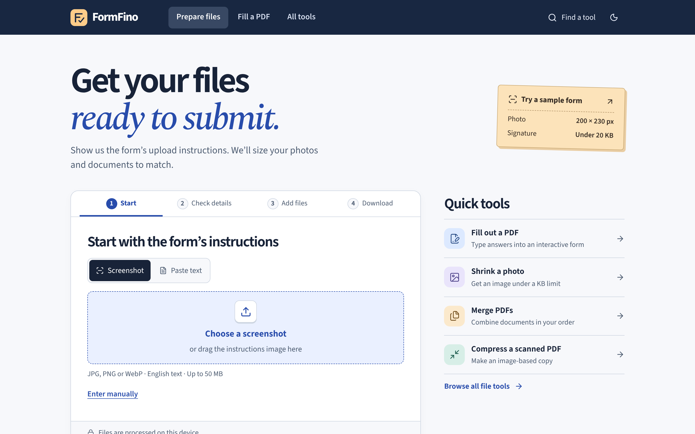
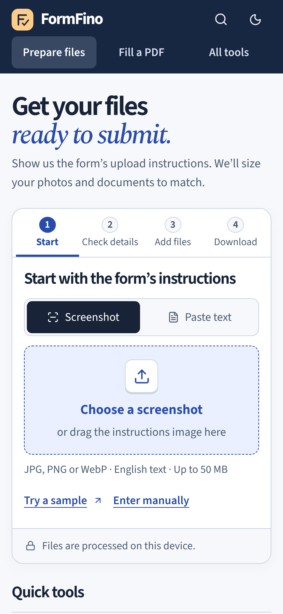
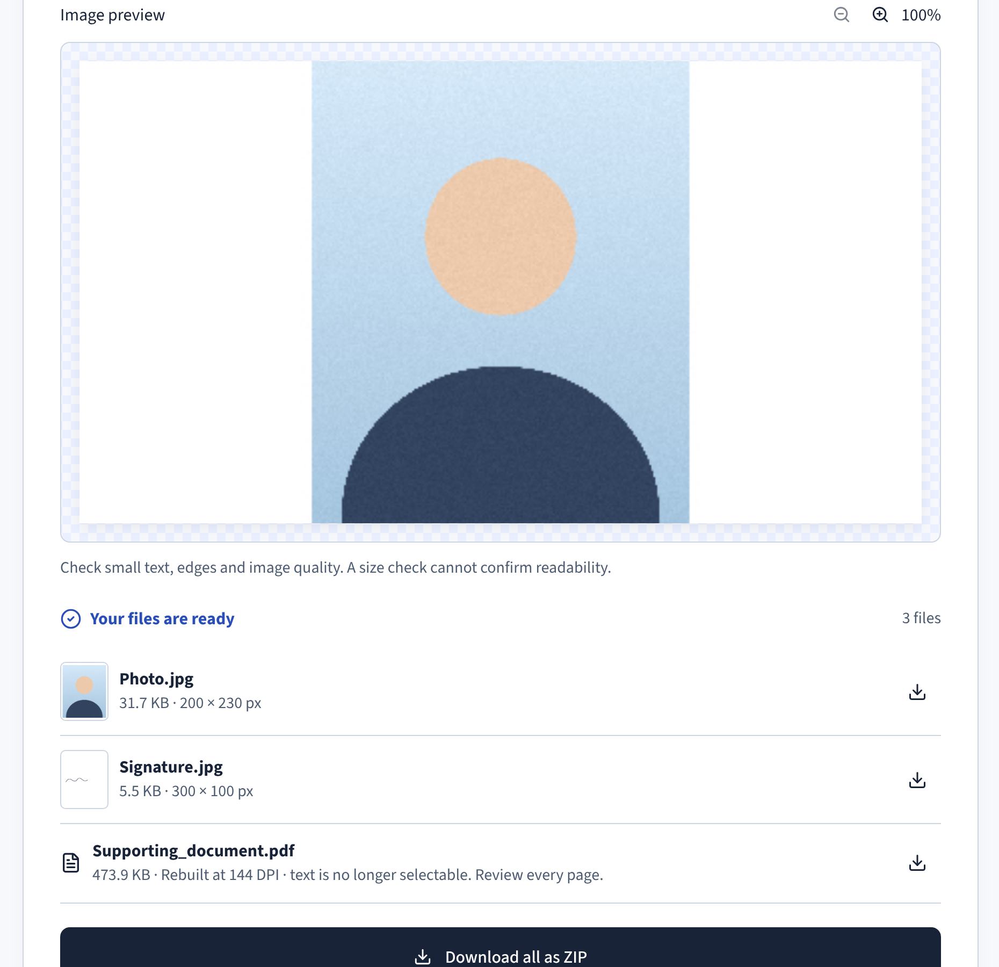
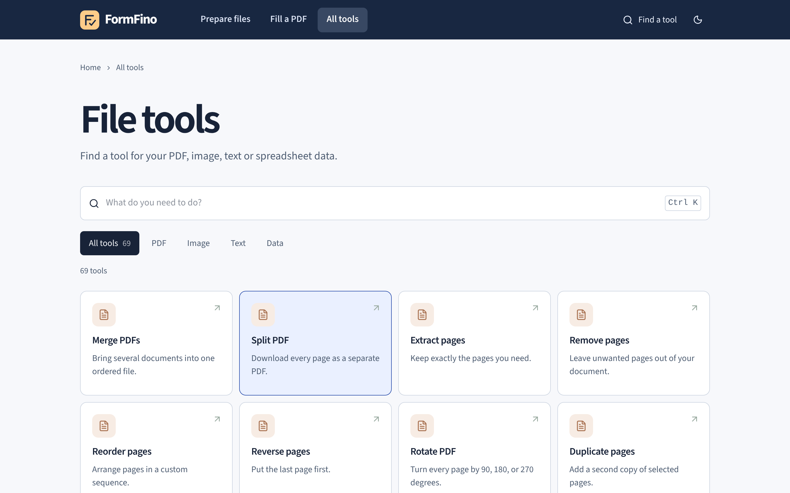
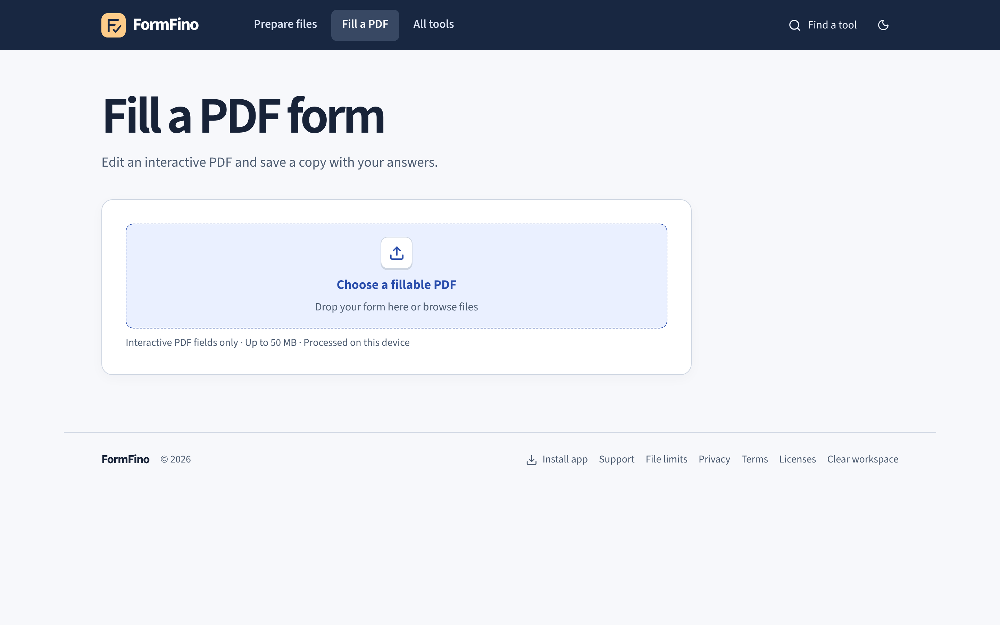

<p align="center">
  
</p>

<h1 align="center">FormFino</h1>

<p align="center">
  <b>Get your files ready to submit.</b><br />
  Turn a screenshot of a form's upload rules into a correctly sized photo, signature and PDF, without uploading anything.
</p>

<p align="center">
  <a href="https://formfino.vercel.app"><b>formfino.vercel.app</b></a>
  &nbsp;|&nbsp; <a href="https://formfino.vercel.app">Prepare files</a>
  &nbsp;|&nbsp; <a href="https://formfino.vercel.app/#fill">Fill a PDF</a>
  &nbsp;|&nbsp; <a href="https://formfino.vercel.app/#tools">All 69 tools</a>
</p>

<p align="center">
  <a href="https://github.com/agarwalpranay02/formfino/actions/workflows/ci.yml"></a>
</p>

<p align="center">
  
  
</p>

## The problem

Every exam, job and visa portal wants something slightly different: a JPG photo of exactly 200 × 230 px between 20 and 50 KB, a signature under 20 KB, a supporting PDF under 500 KB. People end up bouncing between five websites, uploading their identity documents to each one, and still getting "file size not within limit".

FormFino does the whole job in one place, on the user's own device.

## What it does

- **Prepare files.** Drop in a screenshot of the portal's instructions (or paste the text). FormFino reads it, lists each requirement (format, width, height, minimum and maximum KB), and asks you to confirm or correct the values. Add your originals and download a ZIP of files that meet every limit, plus a technical check report.
- **Fill a PDF.** Open an interactive PDF form, type into its fields, preview, and download the filled copy.
- **69 file tools.** 26 PDF tools (merge, split, reorder, rotate, compress, page numbers, watermark and more), 20 image tools (convert, resize, crop, compress to a KB target, OCR), 16 text tools and 7 data tools (CSV and JSON).
- **Installable.** A web app manifest, icons and a service worker let it install to a phone's home screen or a desktop dock.

Nothing is uploaded. There is no file-upload API, no database and no external OCR or AI service. Files are processed in the browser and originals are never changed.

## Example

Measured on the live site with the built-in sample form:

| File | Requirement | Original | Prepared |
|---|---|---:|---:|
| Photo | JPG, 200 × 230 px, 20–50 KB | 2.1 MB | 46.0 KB, 200 × 230 px |
| Signature | JPG, 300 × 100 px, up to 20 KB | 58.4 KB PNG | 13.7 KB, 300 × 100 px |
| Supporting document | PDF, up to 500 KB | 11.6 MB, 3 scanned pages | 483.8 KB |

<p align="center">
  
</p>

## How it works

**Reading the rules.** Tesseract.js runs English OCR in the browser with a self-hosted model whose checksum is pinned. A conservative parser groups lines by subject (photo, signature, marksheet and so on), extracts formats, pixel dimensions and decimal KB limits, keeps the source text beside each value, and never guesses a unit. The user confirms every value before anything is processed.

**Images.** The image is resized to the exact pixel size, either padded with white or cropped to fill, with an adjustable crop position. For a maximum size, a 12-step binary search finds the highest JPEG quality that fits. If the result is below the minimum, FormFino pads the JPEG file itself so the pixels stay the same.

**PDFs.** A PDF already inside the limit is passed through untouched. Otherwise it is re-saved losslessly with object streams. Only if that is still too large are the pages (up to 20) rebuilt as images at the highest resolution that fits, and the user is told the text is no longer selectable. Digitally signed PDFs are refused, because compressing them would break the signature.

**Limits.** File size, pixel count, page count, batch size and text length are bounded so a large file cannot freeze a phone.

## Built with

Next.js 16 (App Router), React 19, TypeScript, Tailwind CSS 4, pdf-lib, PDF.js, Tesseract.js, fflate and Papa Parse. Deployed on Vercel.

<p align="center">
  
  
</p>

## Quality and security

- 54 unit tests cover requirement parsing, limits, file validation, PDF form round trips, analytics privacy and the service worker.
- A browser suite of 91 checks runs every one of the 69 tools on generated files, plus regression cases and the full prepare-files workflow. It runs on a development-only route that returns 404 in production.
- GitHub Actions runs the tests, a production build and a dependency audit on every push.
- A per-request CSP nonce and strict security headers are set on every page, and unsupported write methods are rejected.
- Vercel Web Analytics counts page views only. Page URLs are cleaned and Do Not Track and Global Privacy Control are respected. No document data is ever sent.

See [RELEASE.md](RELEASE.md) for the checks run on the current release and [SECURITY.md](SECURITY.md) for reporting a vulnerability.

## Run it locally

Requires Node.js 24 and pnpm 11.25.0.

```sh
pnpm install --frozen-lockfile
pnpm dev          # http://127.0.0.1:3000, browser suite at /qa
pnpm test
pnpm typecheck
pnpm build && pnpm start
```

No API keys, database or environment variables are needed. To deploy, import the repository into Vercel as a Next.js project on Node 24; the install and build commands are pinned in `vercel.json`.

## Limits

OCR is English only and its results always need a human check. HEIC photos must first be exported as JPEG or PNG. Very large PDFs can exceed a phone's memory even within the file-size limit. Work in progress is not saved, so download files before closing the tab.

## Rights

Source and design © 2026 Pranay Agarwal. All rights reserved. Third-party software keeps its own licences; see [public/THIRD_PARTY_NOTICES.txt](public/THIRD_PARTY_NOTICES.txt) and the font licences in `public/fonts`. Support: formfino@gmail.com.

Built by [Pranay Agarwal](https://pranay-agarwal.vercel.app).
